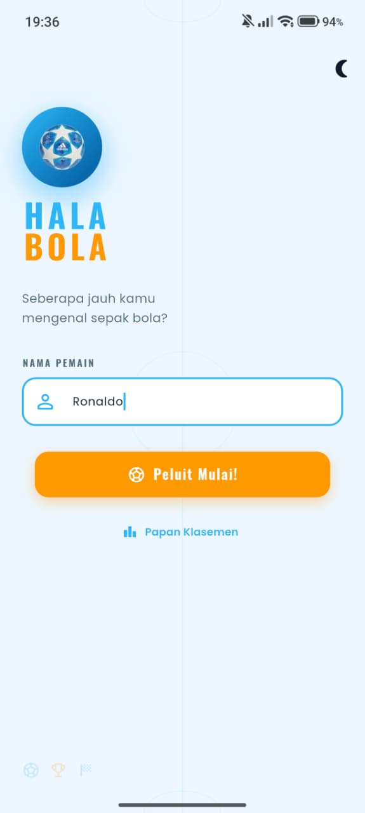
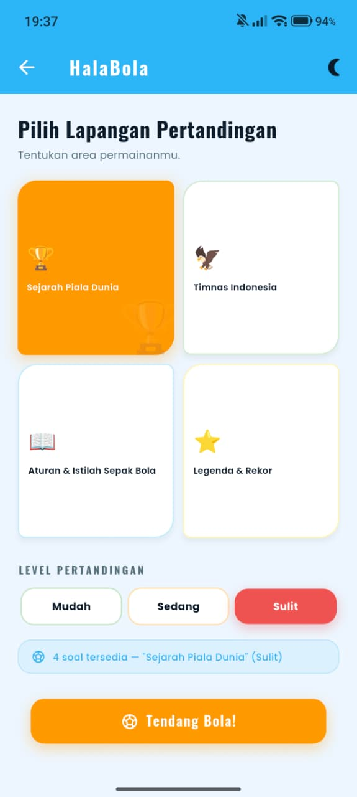
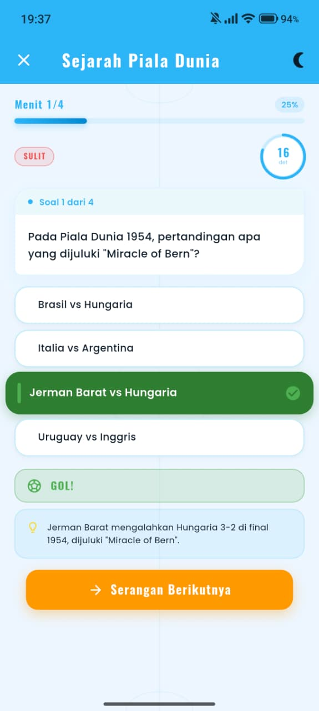
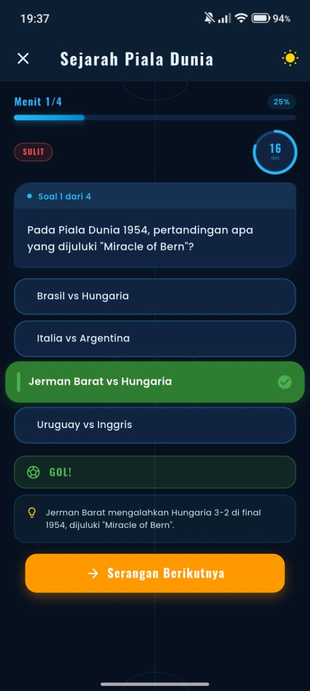
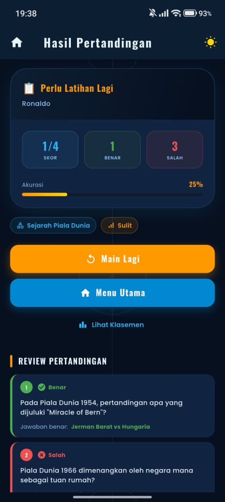
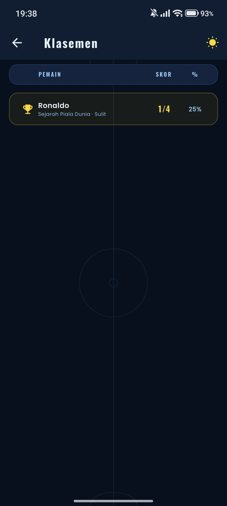
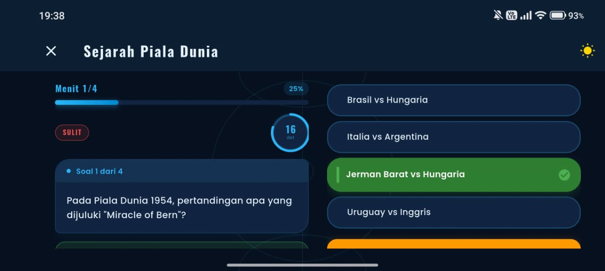

# HalaBola ⚽

Aplikasi Kuis Sepak Bola Interaktif berbasis Flutter.

## a. Identitas Mahasiswa

| Informasi | Detail | 
| ----- | ----- | 
| **Nama** | Marcello Frans Mardohae Pakpahan | 
| **NIM** | 241401104 | 
| **Lab** | Pemrograman Mobile 4 (PM 4) | 
| **Mata Kuliah** | Praktikum Pemrograman Mobile | 
| **Proyek** | UTS – Aplikasi Kuis Pilihan Ganda | 

## b. Informasi Aplikasi

### i. Nama Aplikasi

**HalaBola**

### ii. Deskripsi Singkat Aplikasi

**HalaBola** adalah aplikasi kuis pilihan ganda (*multiple-choice*) bertema sepak bola yang dibangun menggunakan *framework* Flutter. Aplikasi ini memungkinkan pengguna untuk memasukkan nama pemain, memilih topik bahasan serta tingkat kesulitan pertandingan, lalu menjawab rangkaian pertanyaan dengan batas waktu (*countdown timer*) layaknya pertandingan sepak bola sesungguhnya. Di akhir sesi, pemain dapat melihat papan skor, predikat kemampuan, ulasan jawaban beserta fakta penjelasannya, hingga peringkat mereka di papan klasemen (*leaderboard*).

### iii. Fitur-Fitur yang Tersedia

#### Fitur Utama & Kriteria Wajib:

1. **Input & Validasi Nama Pemain (`WelcomeScreen`):** Pengguna wajib memasukkan nama (minimal 2 karakter) sebelum memulai kuis, dilengkapi dengan animasi pantulan bola pada logo utama.

2. **Pemilihan Kategori & Level Kesulitan (`CategoryScreen`):** Tersedia **4 kategori** (*Sejarah Piala Dunia*, *Timnas Indonesia*, *Aturan & Istilah Sepak Bola*, serta *Legenda & Rekor*) dan **3 tingkat kesulitan** (*Mudah*, *Sedang*, *Sulit*) dengan total **48 soal** yang diacak otomatis beserta urutan opsinya di setiap sesi.

3. **Kuis Interaktif dengan Timer (`QuizScreen`):**

   * *Countdown timer* 20 detik per pertanyaan dengan perubahan warna indikator otomatis (Biru $\rightarrow$ Oranye $\rightarrow$ Merah).

   * *Progress bar* menit pertandingan yang dinamis.

   * Animasi tombol pilihan jawaban (*pop* saat benar, *shake* saat salah) serta *status banner* ala komentator sepak bola (**"GOL!"**, **"Offside!"**, dan **"Waktu Habis, Kartu Kuning!"**).

   * Kartu penjelasan fakta sepak bola (`_ExplainCard`) yang langsung tampil setelah pengguna memilih jawaban.

4. **Papan Skor, Predikat & Evaluasi Jawaban (`ResultScreen`):** Menampilkan total skor, persentase akurasi, predikat pemain (mulai dari *Perlu Latihan Lagi* hingga *Ballon d'Or!*), efek perayaan *confetti* otomatis untuk skor $\ge 75\%$, serta daftar ulasan (*review*) jawaban per nomor.

5. **Papan Klasemen (`LeaderboardScreen`):** Mencatat dan mengurutkan riwayat skor pemain tertinggi secara lokal di dalam memori selama sesi aplikasi berjalan.

6. **State Management (`Provider` / `ChangeNotifier`):** Menggunakan `QuizProvider` dan `ThemeProvider` sehingga seluruh progres soal, sisa waktu *timer*, skor, dan tema tampilan tetap terjaga dan tidak hilang meskipun layar perangkat dirotasi atau berpindah halaman.

7. **Ukuran Elemen UI Dinamis (`Responsive` Helper):** Seluruh ukuran teks, ikon, *padding*, dan *margin* dihitung secara proporsional menggunakan `MediaQuery` (`wp`, `hp`, `sp`) tanpa nilai ukuran yang di-*hardcode*.

#### Fitur Bonus:

1. **Dual-Theme (Light & Dark Mode):** Mendukung pergantian tema Terang dan Gelap secara *real-time* melalui tombol `ThemeToggleButton` yang tersedia di setiap halaman.

2. **Adaptive & Responsive Design:** Tata letak otomatis menyesuaikan ukuran layar dan orientasi perangkat:

   * Pada layar *Smartphone* (*Portrait*): Menggunakan tata letak 1 kolom vertikal (`_NarrowLayout`) dan *grid* kategori 2 kolom.

   * Pada layar *Tablet*, *Web Browser*, atau mode *Landscape*: Otomatis beralih ke tata letak 2 kolom berdampingan (`_WideLayout` dan `_WideResult`) serta *grid* kategori 4 kolom.

## c. Dokumentasi

### i. Credit Sumber Aset

| Jenis Aset | Nama Aset | Sumber | Lokasi File | 
| ----- | ----- | ----- | ----- | 
| **Font Heading** | Oswald (Regular & Bold) | [Google Fonts - Oswald](https://fonts.google.com/specimen/Oswald) | `assets/fonts/` | 
| **Font Body** | Poppins (Regular, Medium, SemiBold, Bold) | [Google Fonts - Poppins](https://fonts.google.com/specimen/Poppins) | `assets/fonts/` | 
| **Gambar Logo** | Ilustrasi Bola Sepak (`ball.png`) | Koleksi Aset PNG / Flaticon / Freepik | `assets/images/ball.png` | 
| **Ikon Trofi** | Ikon Piala (`trophy.png`) | [Flaticon](https://www.flaticon.com/) | `assets/icons/trophy.png` | 
| **Ikon UI & Latar** | Material Icons & Custom Painter (`PitchBackground`, `ConfettiOverlay`) | Built-in Flutter SDK | `lib/widgets/` | 

### ii. Screenshot Aplikasi

| Welcome Screen | Category Screen | Quiz Screen (Light) | Quiz Screen (Dark) |
| :---: | :---: | :---: | :---: |
|  |  |  |  |

| Result & Review Screen | Leaderboard Screen | Tampilan Landscape / Responsive |
| :---: | :---: | :---: |
|  |  |  |

### iii. Link Mockup / Prototype Aplikasi

* **Figma Mockup & Prototype:** [HalaBola - Figma Design & Prototype](https://www.figma.com/design/2Uxr2nXxsLE6s0vnvMHusn/haloBola?node-id=0-1&t=ghWALt02oZkIFmFz-1)

## Struktur Proyek

```text
lib/
├── main.dart                          # Entry point aplikasi & setup MultiProvider
├── core/
│   ├── constants.dart                 # Konstanta global, daftar kategori & tingkat kesulitan
│   ├── responsive.dart                # Helper ukuran layar dinamis berbasis MediaQuery
│   ├── routes.dart                    # Konfigurasi named routes & animasi transisi halaman
│   ├── strings.dart                   # Kumpulan teks UI & logika pesan peringkat
│   └── theme.dart                     # Konfigurasi AppColors, AppShapes, Light & Dark Theme
├── data/
│   └── questions_data.dart            # Data lokal berisi 48 soal kuis beserta penjelasan
├── models/
│   ├── question.dart                  # Model data untuk pertanyaan kuis
│   └── quiz_result.dart               # Model untuk AnswerRecord, QuizResult, & LeaderboardEntry
├── providers/
│   ├── quiz_provider.dart             # State management logika kuis, timer, & klasemen
│   └── theme_provider.dart            # State management untuk fitur Dark & Light Mode
├── screens/
│   ├── welcome_screen.dart            # Halaman awal input nama pemain
│   ├── category_screen.dart           # Halaman pemilihan kategori & tingkat kesulitan
│   ├── quiz_screen.dart               # Halaman utama pengerjaan kuis (Portrait & Landscape)
│   ├── result_screen.dart             # Halaman hasil skor akhir & evaluasi jawaban
│   └── leaderboard_screen.dart        # Halaman papan klasemen
└── widgets/
    ├── answer_option_button.dart      # Reusable tombol opsi jawaban dengan animasi
    ├── answer_review_item.dart        # Reusable kartu rincian evaluasi jawaban
    ├── app_logo.dart                  # Reusable widget logo aplikasi dengan aset gambar bola
    ├── category_card.dart             # Reusable kartu pilihan kategori kuis
    ├── confetti_overlay.dart          # Widget animasi partikel confetti
    ├── hb_button.dart                 # Reusable tombol utama aplikasi dengan animasi tekan
    ├── pitch_background.dart          # CustomPainter garis lapangan sepak bola
    ├── primary_button.dart            # Ekspor komponen tombol utama
    ├── progress_bar.dart              # Indikator progres menit pertanyaan
    ├── question_card.dart             # Kartu penampil teks soal
    ├── score_card.dart                # Kartu ringkasan skor dan akurasi akhir
    ├── theme_toggle.dart              # Tombol pengubah mode tema Terang/Gelap
    └── timer_widget.dart              # Indikator waktu mundur melingkar

assets/
├── fonts/                             # File font kustom Oswald & Poppins
├── images/                            # File gambar aset (ball.png)
└── icons/                             # File ikon aset (trophy.png)
```

## Daftar Kunci Jawaban Kuis (48 Soal)

| ID | Kategori | Pertanyaan (Ringkas) | Jawaban Benar | 
| ----- | ----- | ----- | ----- | 
| `pw01` | Piala Dunia | Tuan rumah Piala Dunia pertama | Uruguay | 
| `pw02` | Piala Dunia | Jumlah pemain dalam satu tim di lapangan | 11 | 
| `pw03` | Piala Dunia | Negara pemenang Piala Dunia terbanyak | Brasil | 
| `pw04` | Piala Dunia | Tuan rumah Piala Dunia 2022 | Qatar | 
| `pw05` | Piala Dunia | Tahun penyelenggaraan Piala Dunia pertama | 1930 | 
| `pw06` | Piala Dunia | Pencetak gol terbanyak sepanjang sejarah Piala Dunia | Miroslav Klose | 
| `pw07` | Piala Dunia | Pemenang Piala Dunia 2022 di Qatar | Argentina | 
| `pw08` | Piala Dunia | Nama trofi Piala Dunia FIFA saat ini | FIFA World Cup Trophy | 
| `pw09` | Piala Dunia | Pertandingan yang dijuluki "Miracle of Bern" (1954) | Jerman Barat vs Hungaria | 
| `pw10` | Piala Dunia | Negara tuan rumah pemenang Piala Dunia 1966 | Inggris | 
| `pw11` | Piala Dunia | Negara pemenang Piala Dunia 1938 | Italia | 
| `pw12` | Piala Dunia | Jumlah negara peserta Piala Dunia 1930 | 13 | 
| `ti01` | Timnas Indonesia | Julukan resmi Timnas Sepak Bola Indonesia | Garuda Nusantara | 
| `ti02` | Timnas Indonesia | Organisasi sepak bola nasional Indonesia | PSSI | 
| `ti03` | Timnas Indonesia | Stadion terbesar di Indonesia | Stadion Gelora Bung Karno | 
| `ti04` | Timnas Indonesia | Nama tim Indonesia saat tampil di Piala Dunia 1938 | Hindia Belanda | 
| `ti05` | Timnas Indonesia | Kompetisi sepak bola liga tertinggi di Indonesia | Liga 1 | 
| `ti06` | Timnas Indonesia | Tahun berdirinya PSSI | 1930 | 
| `ti07` | Timnas Indonesia | Tahun Indonesia menjadi tuan rumah Asian Games pertama | 1962 | 
| `ti08` | Timnas Indonesia | Konfederasi sepak bola Asia tempat Indonesia bernaung | AFC | 
| `ti09` | Timnas Indonesia | Tahun pertama partisipasi Indonesia di SEA Games | 1977 | 
| `ti10` | Timnas Indonesia | Klub Indonesia di capaian tinggi Liga Champions Asia | PSM Makassar | 
| `ti11` | Timnas Indonesia | Pencetak gol terbanyak Timnas di AFF Cup | Bambang Pamungkas | 
| `ti12` | Timnas Indonesia | Warna kostum utama Timnas Indonesia | Merah-Putih | 
| `ar01` | Aturan & Istilah | Durasi normal pertandingan sepak bola (2 babak) | 90 menit | 
| `ar02` | Aturan & Istilah | Pengertian "offside" dalam sepak bola | Pemain penyerang berada lebih dekat ke gawang lawan dari bola saat bola dimainkan | 
| `ar03` | Aturan & Istilah | Kartu yang langsung mengeluarkan pemain dari lapangan | Kartu Merah | 
| `ar04` | Aturan & Istilah | Jarak minimum pemain lawan saat tendangan bebas | 9,15 meter | 
| `ar05` | Aturan & Istilah | Pengertian "hat-trick" dalam sepak bola | Tiga gol dalam satu pertandingan oleh pemain yang sama | 
| `ar06` | Aturan & Istilah | Panjang lapangan sepak bola standar FIFA | 100–110 meter | 
| `ar07` | Aturan & Istilah | Kepanjangan dari "VAR" dalam sepak bola modern | Video Assistant Referee | 
| `ar08` | Aturan & Istilah | Jumlah maksimal pemain cadangan di kompetisi resmi FIFA | 9 | 
| `ar09` | Aturan & Istilah | Pengertian aturan "Golden Goal" | Gol pertama yang dicetak di babak perpanjangan waktu dan langsung mengakhiri pertandingan | 
| `ar10` | Aturan & Istilah | Lebar gawang standar FIFA | 7,32 meter | 
| `ar11` | Aturan & Istilah | Arti istilah tendangan "Panenka" | Tendangan penalti dengan chip lambat ke tengah gawang | 
| `ar12` | Aturan & Istilah | Hukuman jika kiper menangkap bola dari umpan kaki rekan setim | Tendangan bebas tidak langsung untuk lawan | 
| `lr01` | Legenda & Rekor | Pemain yang dijuluki "Il Fenomeno" | Ronaldo Nazário | 
| `lr02` | Legenda & Rekor | Negara tempat lahirnya Pelé | Brasil | 
| `lr03` | Legenda & Rekor | Negara asal Diego Maradona | Argentina | 
| `lr04` | Legenda & Rekor | Penghargaan individu tahunan pemain terbaik dunia | Ballon d'Or | 
| `lr05` | Legenda & Rekor | Pencetak "Gol Tangan Tuhan" di Piala Dunia 1986 | Maradona | 
| `lr06` | Legenda & Rekor | Negara yang diwakili oleh Zinedine Zidane | Prancis | 
| `lr07` | Legenda & Rekor | Jumlah raihan Ballon d'Or Lionel Messi hingga 2023 | 8 | 
| `lr08` | Legenda & Rekor | Klub profesional pertama Cristiano Ronaldo | Sporting CP | 
| `lr09` | Legenda & Rekor | Pencetak gol tercepat dalam sejarah putaran final Piala Dunia | Hakan Şükür | 
| `lr10` | Legenda & Rekor | Rekor gol terbanyak dalam satu edisi Piala Dunia (Just Fontaine) | 13 | 
| `lr11` | Legenda & Rekor | Stadion kandang klub FC Barcelona | Camp Nou | 
| `lr12` | Legenda & Rekor | Penjaga gawang legendaris berjuluk "The Black Spider" | Lev Yashin | 

## Cara Menjalankan Proyek

1. Pastikan **Flutter SDK** sudah terpasang di perangkat kamu.

2. Masuk ke direktori proyek:

   ```bash
   cd halabola
   ```

3. Unduh seluruh *dependencies*:

   ```bash
   flutter pub get
   ```

4. Jalankan aplikasi ke perangkat Android / Emulator / Browser:

   ```bash
   flutter run
   ```
